# SYDT — CTF Operations Chat Platform

GitHub repository name: **CTF Chat** (`ctf-chat`). The application title inside the product stays SYDT.

A production-grade realtime communication platform built for cyber-security CTF operations. Discord-style channels, granular RBAC, live scoreboard, support tickets, incident management, and a polished cyber/neon dark UI — all wired to a real Socket.IO realtime layer with seeded demo data.

> Full-stack TypeScript monorepo. **Phase 1 + Realtime slice** as defined in the design plan.

---

## Stack

| Layer    | Tech                                                                                                                              |
| -------- | --------------------------------------------------------------------------------------------------------------------------------- |
| Web      | Next.js 15 (App Router) · React 19 · TypeScript · Tailwind 3 · shadcn/ui · Framer Motion · TanStack Query · Zustand · Socket.IO client · React Hook Form + Zod · Recharts · `react-virtuoso` · `react-markdown` + Shiki · `cmdk` · `sonner` |
| Server   | Node 20 · Express · Socket.IO · Prisma (SQLite dev, Postgres-portable schema) · argon2 · JWT (httpOnly cookies) · Helmet · CORS · `express-rate-limit` · Pino |
| Shared   | RBAC matrix (`Role` × `Permission`) · Zod schemas · Typed `ServerToClient`/`ClientToServer` Socket.IO events                       |

---

## Repository layout

```
sydt-chat/
├── apps/
│   ├── web/         Next.js 15 + React 19 frontend
│   └── server/      Express + Socket.IO + Prisma backend
├── packages/
│   └── shared/      RBAC, Zod schemas, typed socket events, shared DTOs
├── pnpm-workspace.yaml
└── package.json     concurrently-based dev script
```

---

## Quick start

Prereqs: **Node ≥ 20** and **pnpm 9** (`corepack enable && corepack prepare pnpm@9.15.0 --activate`).

```bash
# 1. install workspaces
pnpm install

# 2. push the Prisma schema to SQLite (apps/server/dev.db)
pnpm db:push

# 3. seed the demo dataset (teams, users, channels, challenges, messages, ...)
pnpm seed

# 4. boot both apps concurrently
pnpm dev
```

| Service | URL                       |
| ------- | ------------------------- |
| Web     | http://localhost:3100     |
| API     | http://localhost:4000/api |
| Health  | http://localhost:4000/health |

> The web port is `3100` (not 3000) to avoid conflicts with other dev servers; the API CORS origin is preconfigured to match in `apps/server/.env`.

### Hızlı başlangıç

Gerekenler: **Node.js 20+** ve **pnpm 9.15.0**.

```bash
corepack enable
corepack prepare pnpm@9.15.0 --activate
pnpm install
cp apps/server/.env.example apps/server/.env
cp apps/web/.env.local.example apps/web/.env.local
```

`apps/server/.env` içindeki `JWT_ACCESS_SECRET` ve `JWT_REFRESH_SECRET` değerlerini en az 32 karakterlik, birbirinden farklı dizeler yapın. `apps/web/.env.local` içindeki `JWT_ACCESS_SECRET` sunucudaki erişim sırrıyla aynı olmalıdır.

```bash
pnpm db:generate
pnpm db:migrate
pnpm seed
pnpm dev
```

| Servis | Adres |
| --- | --- |
| Web | http://localhost:3100 |
| API | http://localhost:4000/api |
| Sağlık | http://localhost:4000/health |

Girişte kullanıcı adı veya `<kullanici>@sydt.local` e-postası kullanılır. Tohum hesapları yukarıdaki demo tablosuyladır. Üretimde `NODE_ENV=production`, `COOKIE_SECURE=true` ve `CORS_ORIGIN` tam site adresi olmalıdır. Şema için `pnpm db:push` yerine `pnpm db:migrate` kullanın.

---

## Demo credentials

All accounts created by the seed script.

| Role             | Username                         | Password         |
| ---------------- | -------------------------------- | ---------------- |
| Super Admin      | `admin`                          | `Admin!2345`     |
| Super Admin      | `odin`                           | `Admin!2345`     |
| Comp Admin       | `freya` · `loki`                 | `Admin!2345`     |
| Challenge Author | `thor` · `sif`                   | `Admin!2345`     |
| Moderator        | `heimdall` · `tyr`               | `Admin!2345`     |
| Team Captain     | `cap-<team-slug>` (e.g. `cap-sigma-si`) | `Operator!2345` |
| Team Member      | `<team-slug>-mX` (e.g. `sigma-sigops-m1`) | `Operator!2345` |

Sign in with any of these on the `/login` page (you can use either the username or the email `<username>@sydt.local`).

---

## Keyboard shortcuts

| Action                    | Shortcut       |
| ------------------------- | -------------- |
| Open command palette      | `Ctrl/⌘ + K`   |
| Close palette / modals    | `Esc`          |
| Send chat message         | `Enter`        |
| Newline in chat composer  | `Shift + Enter`|
| Search in command palette | type a query   |

---

## Architecture highlights

- **Auth.** Argon2 hashing; short-lived access JWT in an httpOnly cookie + long-lived refresh JWT in another httpOnly cookie. Refresh endpoint rotates the refresh token. Axios interceptor catches `401` → retries via `/auth/refresh`. Socket.IO handshake authenticates with the same cookie.
- **RBAC.** `packages/shared/src/rbac.ts` is the single source of truth for `Role` × `Permission`. Server enforces via `requirePermission()` middleware **and** per-event guards inside Socket.IO handlers. Web mirrors via `<Can>` component and `useCan()` hook, and `apps/web/src/middleware.ts` performs a route-level redirect when unauthenticated.
- **Realtime.** Socket.IO rooms: `ch:<id>`, `team:<id>`, `staff`, `global`. Typed `ServerToClientEvents` / `ClientToServerEvents` are imported by both apps. The web `SocketBridge` translates incoming events into TanStack Query cache mutations + Zustand store updates (no double source of truth).
- **Chat.** `react-virtuoso` virtualized list, cursor-paginated upward, Shiki for code blocks, custom IOC/IP/hash/URL/JSON/terminal highlighting on top of `react-markdown`. Reactions, replies, edit/delete with optimistic updates, typing indicators, presence.
- **Scoreboard.** Snapshot cached server-side and broadcast as `scoreboard:update` every 5 s. Rank changes animate via Framer Motion. Recharts solve-timeline + category-mix.
- **Tickets.** Full lifecycle: open → claim → in-progress → resolved → closed. Internal-note tab gated behind `TICKET_INTERNAL_NOTE` permission. Realtime push to staff + reporter.
- **Admin.** RBAC-gated `/admin` overview: KPI cards, Recharts activity stream (5-min buckets × 2 h), staff online list, audit log. Other admin sub-pages are clearly labeled as forthcoming.
- **Notifications.** WebAudio-synthesized cyber-feel sound effects, sonner toasts, browser `Notification` API for mentions/announcements/tickets, in-app notification center popover with sound + DND toggles.

---

## NPM scripts (root)

```bash
pnpm dev          # run both apps (server + web) with colored, prefixed logs
pnpm build        # build shared → server → web
pnpm typecheck    # tsc --noEmit across all workspaces
pnpm db:push      # apply Prisma schema to dev.db
pnpm db:generate  # regenerate Prisma client
pnpm seed         # populate demo dataset
pnpm format       # prettier --write across the repo
```

---

## Environment

Server reads `apps/server/.env` (see `apps/server/.env.example`):

```env
NODE_ENV=development
PORT=4000
DATABASE_URL="file:./dev.db"
JWT_ACCESS_SECRET=...     # ≥ 32 chars
JWT_REFRESH_SECRET=...    # ≥ 32 chars (different from access)
ACCESS_TOKEN_TTL=900
REFRESH_TOKEN_TTL=2592000
CORS_ORIGIN=http://localhost:3100
COOKIE_SECURE=false       # set to true behind HTTPS
SERVER_INVITE_TTL_DAYS=7  # default expiry for new server invites
LOG_LEVEL=info
```

Web reads `apps/web/.env.local` (see `apps/web/.env.local.example`):

```env
NEXT_PUBLIC_API_ORIGIN=http://localhost:4000
# Must match apps/server JWT_ACCESS_SECRET for Edge middleware JWT checks
JWT_ACCESS_SECRET=...
```

### Production security checklist

When deploying behind HTTPS, set these on the API (`apps/server/.env`):

| Variable | Production value | Notes |
| -------- | ---------------- | ----- |
| `NODE_ENV` | `production` | Enables strict env guards |
| `COOKIE_SECURE` | `true` | **Required** in production — cookies only over HTTPS |
| `CORS_ORIGIN` | exact web origin(s) | Comma-separated; wildcards (`*`) are rejected |
| `ALLOW_BEARER_AUTH` | omit or `false` | Prefer cookie-only auth; Bearer is dev-only by default |
| `JWT_*_SECRET` | strong random strings | ≥ 32 chars, unique per secret |

The web client sends a double-submit CSRF token (`X-CSRF-Token`) on mutating requests. Login/register pages bootstrap the token via `GET /api/auth/csrf` before the first POST. Helmet CSP headers are enabled on both API and Next.js.

---

## Features / Özellikler

Screenshots below come from a fresh `pnpm seed` database. People, teams, messages, tickets and incidents are fictional demo records (`@sydt.local`). They are not production data.

Aşağıdaki görüntüler temiz bir `pnpm seed` veritabanından alındı. Kişiler, takımlar, mesajlar, talepler ve olaylar kurgusal demo kayıtlarıdır (`@sydt.local`). Üretim verisi içermez.

### Sign in / Giriş

Argon2 passwords, short-lived access JWT and rotating refresh JWT in httpOnly cookies, double-submit CSRF, forced password change, and disabled accounts. Register, invite links and the acceptable-use policy are part of the same flow. The interface is Turkish and English.

Argon2 parola, httpOnly çerezlerde kısa ömürlü erişim JWT’si ve dönen yenileme JWT’si, çift gönderimli CSRF, zorunlu parola değişimi ve pasif hesaplar. Kayıt, davet bağlantısı ve kullanım kuralları aynı akıştadır. Arayüz Türkçe ve İngilizcedir.

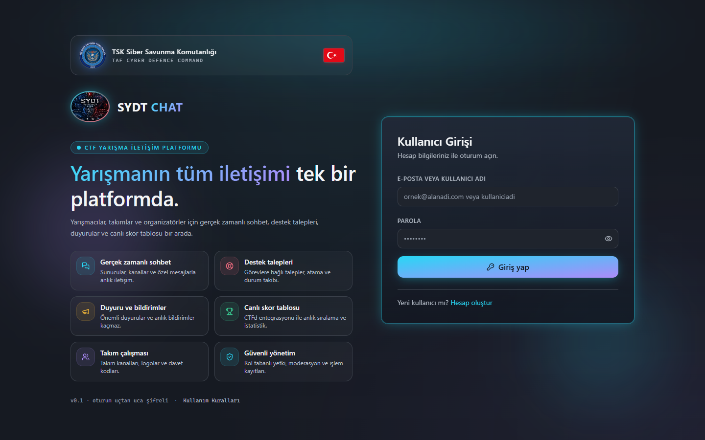

### Servers, channels and realtime chat / Sunucular, kanallar ve sohbet

Multiple chat servers, categories, channel types (global, announcement, challenge, staff, team room, support), per-server roles and a permission matrix. Team rooms are provisioned per category. New users can be auto-joined.

Chat is Socket.IO: virtualized history, markdown, highlighted code, IOC highlighting, mentions, reactions, replies, edit and delete, typing, presence, attachments and an in-page image lightbox (zoom; click outside to close).

Birden fazla sohbet sunucusu, kategoriler, kanal türleri (genel, duyuru, görev, personel, takım odası, destek), sunucu rolleri ve yetki matrisi. Takım odaları kategori bazında açılır. Yeni kullanıcılar otomatik katılabilir.

Sohbet Socket.IO üzerindedir: sanal kaydırılan geçmiş, markdown, vurgulu kod, IOC vurgusu, bahsetmeler, tepkiler, yanıt, düzenleme ve silme, yazıyor bilgisi, çevrimiçi durum, dosya ekleri ve sayfa içi resim penceresi (yakınlaştırma; dışarı tıklayınca kapanır).

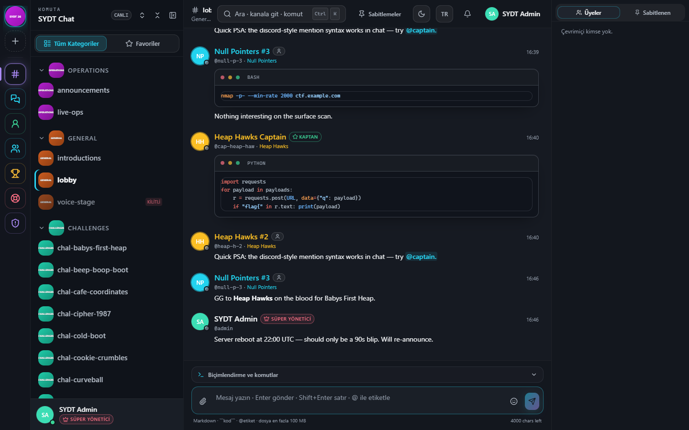

### Direct messages and friends / Özel mesaj ve arkadaşlar

Direct conversations are separate from channel chat. Friend requests are searched among members of the active server.

Özel konuşmalar kanal sohbetinden ayrıdır. Arkadaş isteği, aktif sunucunun üyeleri arasında aranır.

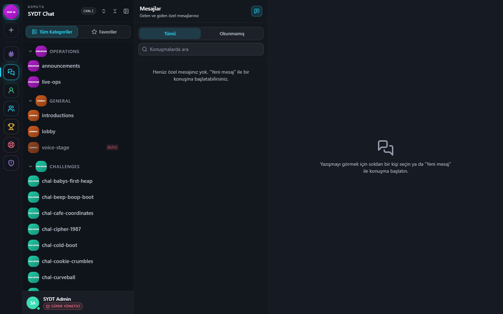

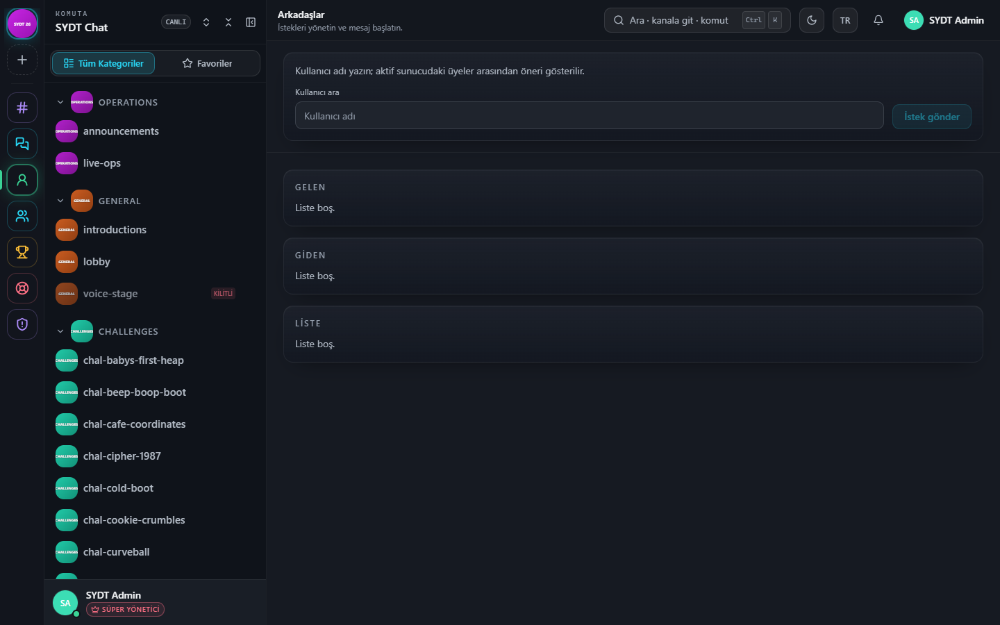

### Challenges, scoreboard and teams / Görevler, skor ve takımlar

Challenges carry category, difficulty, points, hints and a linked discussion channel. Solves update the demo score state. The live ranking page reads a configured CTFd API; with no CTFd connection it stays empty on purpose. Teams join with an invite code or are created in the server.

Görevlerde kategori, zorluk, puan, ipucu ve bağlı tartışma kanalı vardır. Çözümler demo skor durumunu günceller. Canlı sıralama sayfası yapılandırılmış CTFd API’sini okur; CTFd bağlı değilken bilinçli olarak boş kalır. Takımlar davet koduyla katılır veya sunucuda oluşturulur.

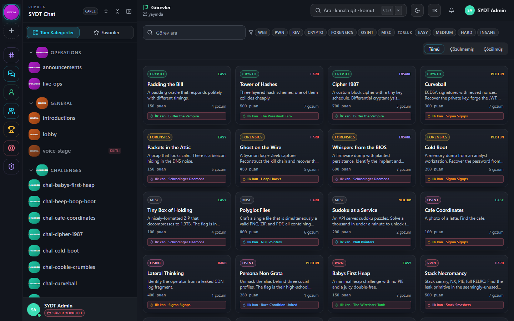

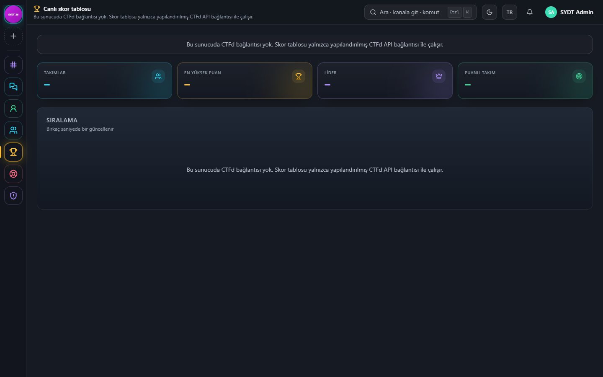

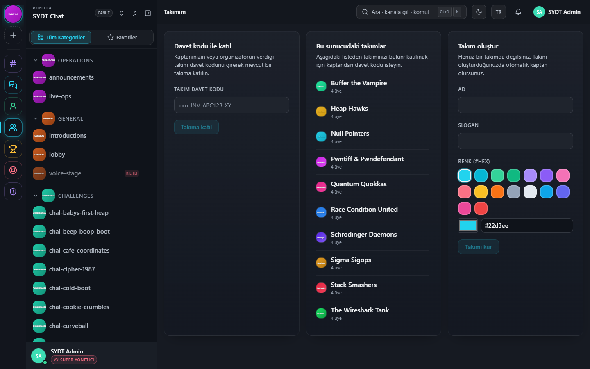

### Tickets and incidents / Destek talepleri ve olaylar

Tickets move through open, claimed, in progress, resolved and closed. Staff can set priority, category, assignee and internal notes, attach files and link related tickets. Incidents track severity and mitigation separately from player support.

Talepler açık, üstlenildi, işlemde, çözüldü ve kapalı durumlarından geçer. Personel öncelik, kategori, atanan kişi ve iç not belirler, dosya ekler ve ilgili talepleri bağlar. Olaylar oyuncu desteğinden ayrı olarak önem ve giderme durumunu izler.

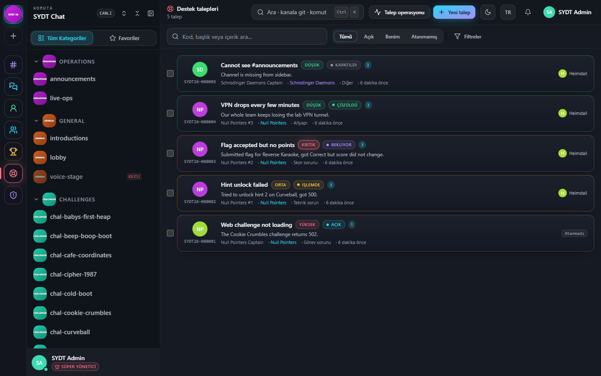

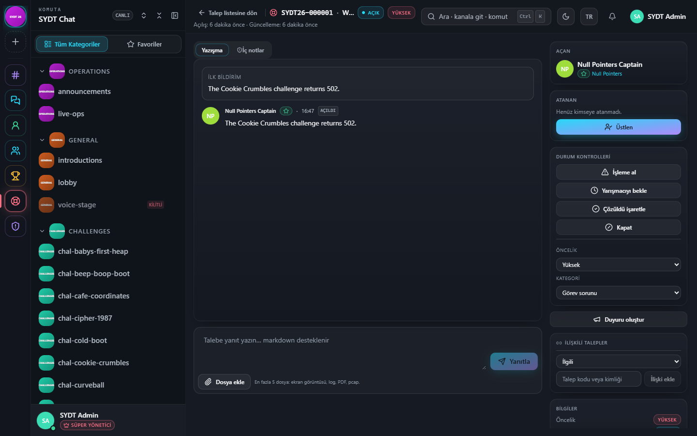

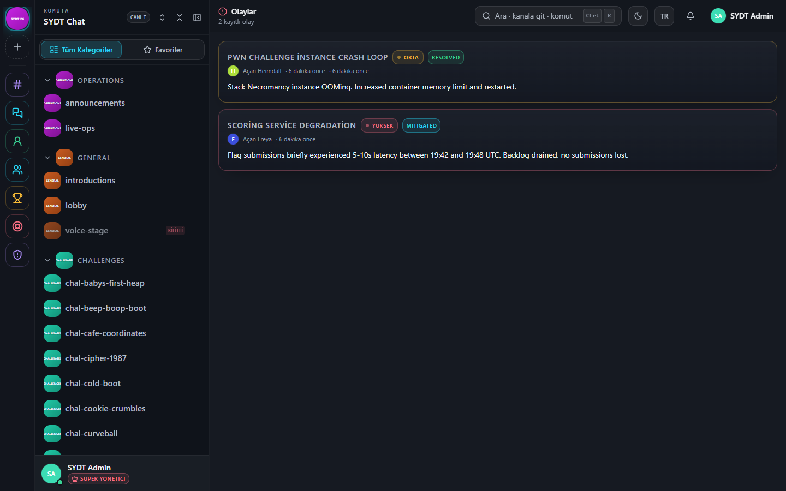

### Administration / Yönetim

The admin area is permission-gated:

- Overview of the active server
- Users: profile, password set/reset, platform role, deactivate, create, filters, CSV, bulk add/move/remove of server membership, auto-join
- Teams and CTFd team import
- System settings, branding, announcements and broadcast DMs
- Surveys with on-screen charts and an editable report exported to PDF
- Custom pages, moderation, audit log, backups

Yönetim alanı yetkiye bağlıdır:

- Aktif sunucunun özeti
- Kullanıcılar: profil, parola belirleme/sıfırlama, platform rolü, pasifleştirme, oluşturma, süzgeç, CSV, toplu sunucu üyeliği ekleme/taşıma/çıkarma, otomatik katılım
- Takımlar ve CTFd takım içe aktarma
- Sistem ayarları, marka, duyurular ve toplu özel mesaj
- Ekrandaki grafiklerle anket ve düzenlenip PDF olarak alınan rapor
- Sayfalar, moderasyon, işlem kaydı, yedekleme

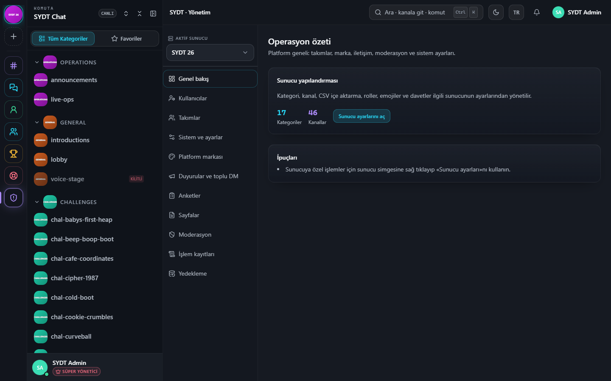

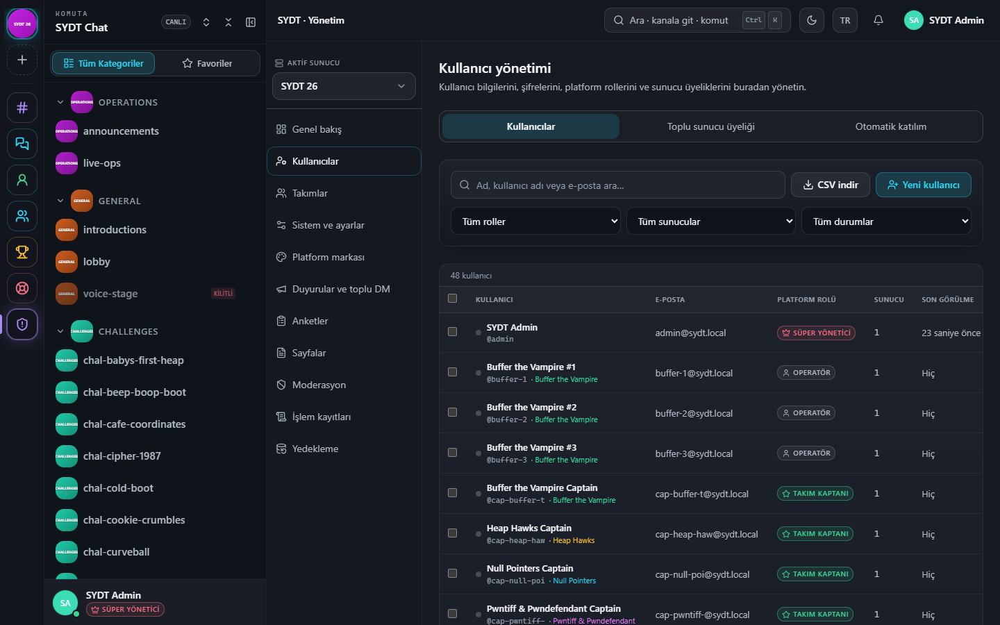

### Notifications and profile / Bildirimler ve profil

In-app notifications, announcement acknowledgement, browser notifications, sound and do-not-disturb. Profile holds display name, avatar, theme and channel notification level.

Uygulama içi bildirimler, duyuru onayı, tarayıcı bildirimi, ses ve rahatsız etme. Profilde görünen ad, fotoğraf, tema ve kanal bildirim düzeyi vardır.

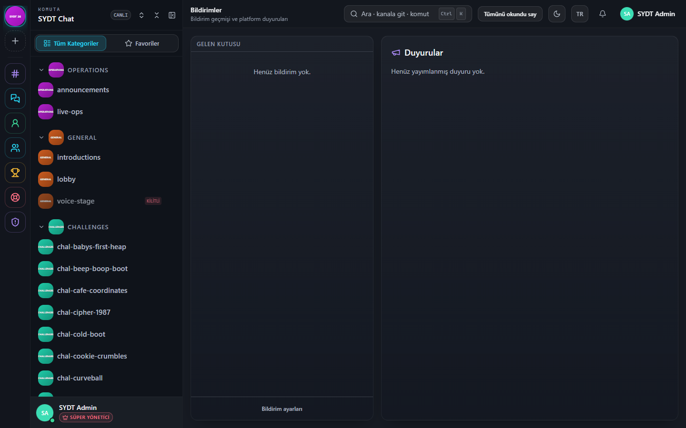

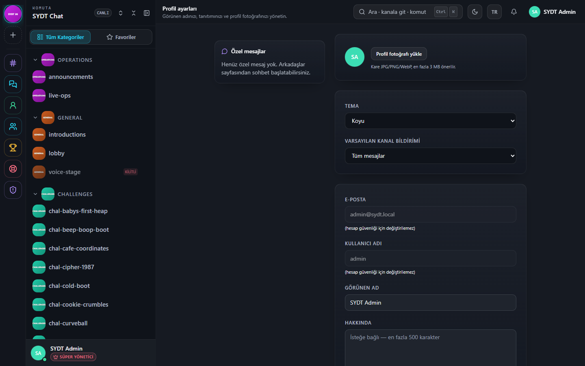

### Also included / Ayrıca

- Command palette (`Ctrl/⌘ + K`)
- Legal acceptable-use pages in Turkish and English
- Optional ClamAV scan of uploads (fail-open)
- Scheduled backups of the database and, optionally, uploads

- Komut paleti (`Ctrl/⌘ + K`)
- Türkçe ve İngilizce kullanım kuralları
- Yüklemeler için isteğe bağlı ClamAV taraması (tarayıcı kapalıyken yükleme engellenmez)
- Veritabanının ve istenirse yüklenen dosyaların zamanlanmış yedeği

### Not in this build / Bu sürümde yok

- Voice channels are a locked placeholder; there is no WebRTC call.
- There is no server-side full-text message index beyond what the client filters.
- Browser push via a service worker is not wired; in-app and browser notifications are.

- Ses kanalları kilitli bir yer tutucudur; WebRTC görüşme yoktur.
- İstemcinin süzdüğünün ötesinde sunucu tarafı tam metin mesaj dizini yoktur.
- Service worker ile tarayıcı push bağlı değildir; uygulama içi ve tarayıcı bildirimleri vardır.

---

## License

Internal / proprietary. Not for redistribution.
